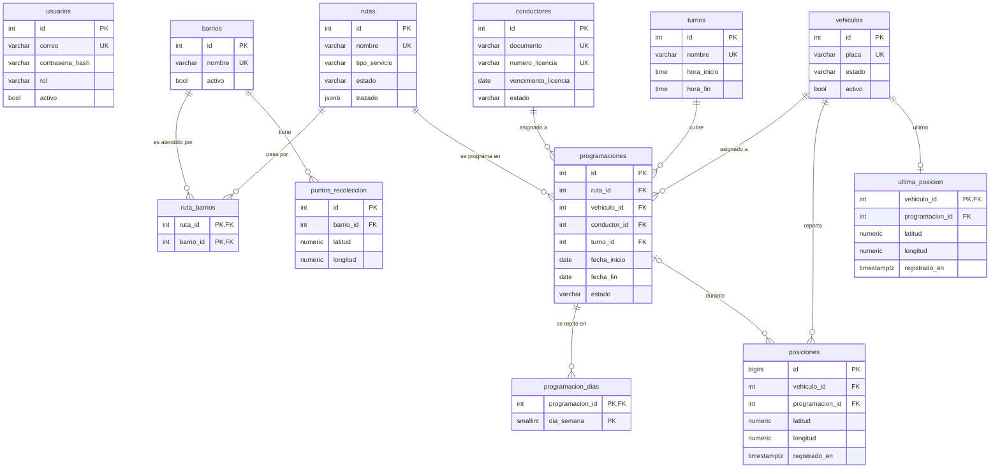

# EcoRuta — Base de datos (PostgreSQL)

Versión 1.0 · 21 de noviembre de 2026 · Responsable: Victor Manuel Vera Angulo (integrante 4, datos y despliegue)
Basada en el documento técnico v1.1 (sección 7), ECO-2, ECO-19, ECO-20 y ECO-33.

## 1. Resumen

- **Motor:** PostgreSQL en Neon (proyecto `ecoruta`, ramas `main` y `dev`). Sin Supabase, como exige el profesor.
- **Cómo se crea:** solo con migraciones (`database/migrations`, node-pg-migrate). Nadie crea tablas a mano en Neon.
- **Contenido:** 12 tablas del modelo + 2 tablas de geografía (`localidades`, `comunas`) + 2 vistas + 2 funciones de apoyo para el dashboard y los conflictos.
- **Convenciones:** nombres en español, sin tildes, minúsculas con guion bajo. Fechas con zona horaria (`timestamptz`). "Desactivar" no borra: cambia `activo` o `estado`.

## 2. Diagrama entidad-relación



`usuarios` es independiente: solo sirve para el login del administrador.

## 3. Migraciones (orden de ejecución)

| # | Archivo | Qué crea | Requerimientos |
|---|---|---|---|
| 1 | `…001_crear-usuarios` | `usuarios`, correo único sin distinguir mayúsculas | RF-01 a RF-05, RNF-01 |
| 2 | `…002_crear-vehiculos` | `vehiculos`, placa única, 4 estados | RF-07 a RF-09 |
| 3 | `…003_crear-conductores` | `conductores`, documento y licencia únicos | RF-10 a RF-12 |
| 4 | `…004_crear-barrios` | `barrios`, nombre único | RF-13 |
| 5 | `…005_crear-rutas` | `rutas` con `trazado` JSONB | RF-14, RF-16 |
| 6 | `…006_crear-ruta-barrios` | Barrios por los que pasa cada ruta | RF-31 |
| 7 | `…007_crear-puntos-recoleccion` | Puntos de recolección por barrio | RF-17 |
| 8 | `…008_crear-turnos` | `turnos` (pueden cruzar la medianoche) | RF-18 |
| 9 | `…009_crear-programaciones` | `programaciones` con FKs y rango de fechas | RF-19 |
| 10 | `…010_crear-programacion-dias` | Días de la semana (1 = lunes … 7 = domingo) | RF-19 |
| 11 | `…011_crear-posiciones` | Historial de posiciones, índice por vehículo y fecha | RF-28 |
| 12 | `…012_crear-ultima-posicion` | Una fila por camión | RF-28, RF-29 |
| 13 | `…013_vistas-y-funciones` | Vistas del dashboard y función de conflictos | RF-21 a RF-24 |
| 14 | `…014_crear-localidades-comunas` | `localidades` (2) y `comunas` (12); `barrios.comuna_id` reemplaza la columna de texto `comuna` | RF-13, RF-31 |
| 15 | `…015_dashboard-servicios-hoy` | Vista `v_rutas_sector` y funciones `fn_programaciones_en_curso`, `fn_servicios_hoy` y `fn_dashboard_resumen` (hora de `America/Bogota`) | RF-22 a RF-24 |

Todas tienen sección `-- Down Migration`; se probó aplicar las 15, deshacerlas todas y volver a aplicarlas.

## 4. Reglas que garantiza la base de datos

| Regla | Cómo |
|---|---|
| Placa, documento y licencia no se repiten (RF-08, RF-11) | `UNIQUE` |
| Barrio, ruta, turno y correo únicos sin importar mayúsculas | Índice único sobre `LOWER(columna)` |
| Estados válidos del vehículo, conductor, ruta y programación | `CHECK` |
| Categoría de licencia colombiana | `CHECK` A1, A2, B1, B2, B3, C1, C2, C3 |
| Trazado: lista de al menos 2 puntos, o `NULL` si aún no se dibuja | `CHECK` sobre JSONB |
| `fecha_fin >= fecha_inicio`; día de la semana entre 1 y 7 | `CHECK` |
| Latitud y longitud dentro de rango | `CHECK` |
| No se borra un vehículo, conductor, ruta, turno o barrio que ya se usa | `ON DELETE RESTRICT` |
| Al borrar una ruta, se van sus barrios; al borrar una programación, sus días | `ON DELETE CASCADE` |
| Al borrar una programación, las posiciones conservan el historial | `ON DELETE SET NULL` |

**Lo que valida el backend (no la base):** RF-20 — vehículo activo y no en mantenimiento o fuera de servicio, conductor activo, ruta activa y con trazado. Dependen del estado de otras tablas y mensajes en español, por eso van en el servicio de programaciones (ECO-24).

## 5. Vistas y funciones de apoyo

### `v_resumen_dashboard` → `GET /api/dashboard/resumen`
Una fila con total de vehículos, disponibles y en mantenimiento; total y activos de conductores; total, activas y suspendidas de rutas; y rutas programadas. Los vehículos cuentan solo los `activo = TRUE`.

```sql
SELECT * FROM v_resumen_dashboard;
```

### `v_programaciones_detalle` → tabla del dashboard
Programaciones con ruta, placa, conductor, turno, horario y arreglo de días. Sirve para los filtros por fecha, ruta, conductor y vehículo (`WHERE ruta_id = $1`, etc.).

### `fn_servicios_del_dia(fecha)` → "servicios del día" (RF-23)
```sql
SELECT * FROM fn_servicios_del_dia(CURRENT_DATE);
```
Devuelve las programaciones en estado `programada` cuyo rango incluye la fecha y que se repiten ese día de la semana.

### `fn_conflictos_programacion(...)` → advertencias (RF-21)
```sql
-- al crear
SELECT * FROM fn_conflictos_programacion(
  $vehiculo, $conductor, $turno, '2026-12-01', '2026-12-31', ARRAY[1,3,5]::smallint[]);
-- al editar: último parámetro = id de la programación que se edita
```
Devuelve `(programacion_id, tipo_conflicto)` con `'vehiculo'` o `'conductor'`. Hay conflicto si otra programación `programada` coincide en fechas, en al menos un día de la semana y en el horario del turno. Si devuelve filas, el backend responde con la advertencia. Los turnos nocturnos (22:00 a 06:00) se tratan como intervalo que termina al día siguiente.

**Limitación conocida:** un turno nocturno se compara contra el mismo día; no detecta que el tramo posterior a la medianoche invade el día siguiente (por ejemplo, una Noche del lunes contra una programación del martes antes de las 06:00). Con los 3 turnos de ejemplo no ocurre; si se agregan turnos que se solapen entre días, hay que ampliar la función.

### Posiciones (RF-28)
```sql
INSERT INTO posiciones (vehiculo_id, programacion_id, latitud, longitud, velocidad_kmh, registrado_en)
VALUES ($1, $2, $3, $4, $5, $6);

INSERT INTO ultima_posicion (vehiculo_id, programacion_id, latitud, longitud, registrado_en)
VALUES ($1, $2, $3, $4, $6)
ON CONFLICT (vehiculo_id) DO UPDATE
  SET programacion_id = EXCLUDED.programacion_id, latitud = EXCLUDED.latitud,
      longitud = EXCLUDED.longitud, registrado_en = EXCLUDED.registrado_en;
```
Las dos sentencias van en una transacción. El mapa lee solo `ultima_posicion`.

## 6. Datos de prueba

`database/seeds/000_geografia.sql` (real): los 104 barrios oficiales de Buenaventura, cada uno con su comuna. Se carga antes que el archivo de prueba y se puede repetir.

`database/seeds/001_datos_prueba.sql` (ficticio): 3 turnos, 5 vehículos (uno por cada estado), 4 conductores, 4 rutas (una suspendida y una sin trazado), puntos de recolección y 2 programaciones para el camión 1 y el camión 2 de la simulación.

- Es útil para probar las validaciones: TUR104 está en mantenimiento, TUR105 fuera de servicio, el conductor `1111111104` está inactivo, "Ruta 3" suspendida y "Ruta 4" sin trazado.
- Los trazados son de ejemplo y pueden caer fuera de las calles: se rehacen desde el mapa (ECO-18).
- Los barrios de las rutas de ejemplo salen del listado oficial (`000_geografia.sql`). Hay dos barrios "Alfonso López": se llaman *Alfonso López Pumarejo* (comuna 3) y *Alfonso López Michelsen* (comuna 12).
- La comuna 8 tiene 7 barrios según el listado oficial; el mapa agrega "Olímpico", pendiente de confirmar.
- **El administrador no está en el seed**: se crea con `npm run crear-admin`.

## 7. Puesta en marcha

1. En Neon, proyecto `ecoruta`: ramas `main` y `dev`; copiar la cadena **directa** (sin `-pooler`) de `dev`.
2. Copiar `.env.example` como `backend/.env` y poner `DATABASE_URL=postgresql://…?sslmode=require`. Nunca subirlo a GitHub.
3. En `backend/package.json` agregar:
   ```json
   "scripts": {
     "migrate": "node-pg-migrate -m ../database/migrations",
     "seed": "node scripts/seed.js",
     "crear-admin": "node scripts/crear-admin.js"
   }
   ```
   y las dependencias: `npm install pg dotenv bcrypt` y `npm install -D node-pg-migrate`.
4. Desde `backend`:
   ```bash
   npm run migrate up                      # crea las tablas, las vistas, las funciones, las 2 localidades y las 12 comunas
   npm run seed                            # datos de prueba (con -- --reset vacía y recarga)
   ADMIN_CORREO=admin@ecoruta.co ADMIN_CONTRASENA='clave-larga' npm run crear-admin
   ```
5. Verificar en Neon, en **Tables** o en el **SQL Editor**: `SELECT * FROM v_resumen_dashboard;`
6. Render ejecuta `npm run migrate up` en cada despliegue (Build Command), con la cadena de la rama `main`.

**Reglas de equipo:** una migración que ya está en `main` no se edita; los cambios van en una migración nueva. Antes de la entrega 1, probar siempre en una rama vacía de Neon.

## 8. Pendientes y decisiones abiertas

- **Cierre de sesión:** la tabla no guarda tokens. Con JWT, el logout es borrar el token en el cliente; si el profesor exige invalidarlo en el servidor, se agrega una migración con `tokens_revocados`.
- **Tipos de servicio:** `recoleccion` y `barrido` (el MER de la universidad habla de recolección y barrido). Si se necesita otro, cambiar el `CHECK` con una migración nueva.
- **PostGIS:** no se usa; el trazado es JSONB. Opcional para distancias y desvíos.
- **Neon gratuito:** confirmar los límites el día de crear la cuenta (la base se suspende tras 5 minutos sin uso).
